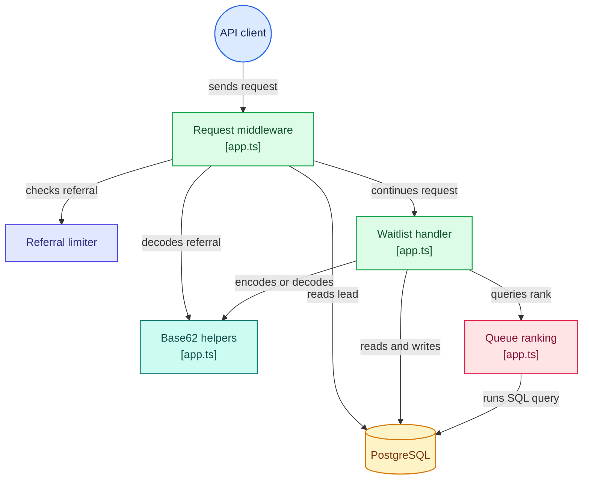

# Waitlister API
A lightweight TypeScript backend built with the Hono web framework that manages product waitlist signups and incentivizes sharing through a built-in referral system. It assigns each subscriber a custom referral link, tracks successful referrals, and calculates real-time leaderboard queue rankings.

# Tech Stack
Language: ```TypeScript```

HTTP Framework: ```Hono```

Database & ORM: ```PostgreSQL, Drizzle ORM, postgres-js driver```

Features: ```Base62 encoding/decoding, SQL window functions, custom middleware rate limiting```

# Architecture


